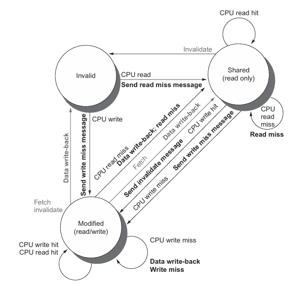
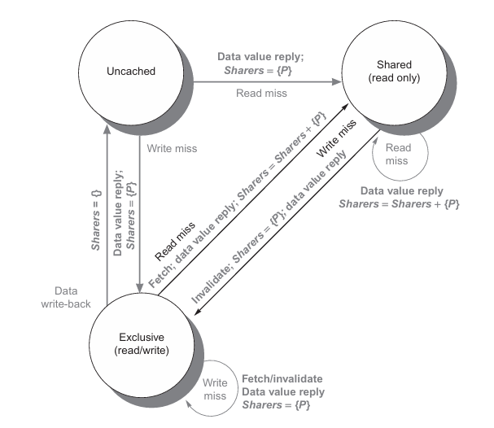

# Unit 2 — Part 2: Distributed Shared-Memory and Directory-Based Coherence

---

## 1. Why Snooping Protocols Fail to Scale: The Need for Directory Protocols

### 1.1 The Scalability Bottleneck of Snooping
In a **snooping-based coherence protocol**, every cache miss (reads of missing blocks and writes to clean/shared blocks) must be **broadcast across a shared physical bus or broadcast interconnect** to all processor caches in the system.
* **The Bandwidth Wall:** Consider a multiprocessor of four 4-core multicores operating at $4\text{ GHz}$. Real-world scientific and commercial applications demand between **$4\text{ to }170\text{ GiB/s}$ of memory bus bandwidth**. A typical high-performance memory subsystem (such as dual-channel DDR4 on an Intel Core i7) supplies only **$34\text{ GiB/s}$**. A single shared bus is instantly saturated.
* **Achilles' Heel:** The absence of a centralized or indexed directory tracking who owns what is both snooping's initial advantage (inexpensive for small systems) and its fatal limitation for scaling beyond 8 to 16 cores.

---

### 1.2 The Solution: Distributed Shared-Memory (DSM) & Directory Protocols
To scale beyond the limits of a single broadcast bus, modern systems adopt **Distributed Shared-Memory (DSM)** architectures:
1. **Physical Memory is Distributed:** Each node possesses a fraction of the global physical address space alongside its local processor core(s) and private caches. This separates **local memory traffic** from **remote memory traffic**.
2. **Point-to-Point Directory Coherence:** Broadcasting on every miss would negate the benefits of distributed memory. Instead, a **directory** is maintained that explicitly tracks the caching state of every memory block.
3. **No Broadcasts:** Coherence messages are sent **only to the specific nodes that actually hold copies** of the requested block.

```
       SNOOPING (Broadcast-Based)                       DIRECTORY (Point-to-Point)
  ┌─────────────────────────────────┐              ┌─────────────────────────────────┐
  │ Miss! ──► Broadcast to ALL      │              │ Miss! ──► Query HOME Directory  │
  │           Cores (N-1 traffic)   │              │           Directory checks      │
  │           Saturates Bus         │              │           Sharers bit-vector    │
  └─────────────────────────────────┘              │           Sends point-to-point  │
                                                   │           invalidations ONLY to │
                                                   │           actual sharers!       │
                                                   └─────────────────────────────────┘
```

---

## 2. Distributed Directory Architecture

```
                    INTERCONNECTION NETWORK (Point-to-Point Topology)
                                       │
         ┌─────────────────────────────┼─────────────────────────────┐
         ▼                             ▼                             ▼
   ┌───────────┐                 ┌───────────┐                 ┌───────────┐
   │  NODE 0   │                 │  NODE 1   │                 │  NODE N   │
   │ ┌───────┐ │                 │ ┌───────┐ │                 │ ┌───────┐ │
   │ │Core(s)│ │                 │ │Core(s)│ │                 │ │Core(s)│ │
   │ │+Caches│ │                 │ │+Caches│ │                 │ │+Caches│ │
   │ └───┬───┘ │                 │ └───┬───┘ │                 │ └───┬───┘ │
   │ ┌───▼───┐ │                 │ ┌───▼───┐ │                 │ ┌───▼───┐ │
   │ │Dir/Mem│ │                 │ │Dir/Mem│ │                 │ │Dir/Mem│ │
   │ └───────┘ │                 │ └───────┘ │                 │ └───────┘ │
   └───────────┘                 └───────────┘                 └───────────┘
```

### 2.1 Node Components
Each node in a distributed-memory multiprocessor typically contains:
* One or more multicore processor chips and their private/shared cache hierarchies (L1, L2, L3).
* A slice of the physical system **Main Memory**.
* A **Directory** associated with that local slice of memory.
* An interface to the **Interconnection Network** and I/O.

### 2.2 Node Terminology in Directory Transactions
Every coherence transaction involves up to three distinct node roles:
1. **Local Node (Requester):** The node where the CPU memory request (read miss or write miss) originates.
2. **Home Node:** The node whose physical memory partition contains the requested memory address and its corresponding directory entry.
   * *Physical Address Mapping:* Address bits statically determine the home node (e.g., upper bits select the node number, lower bits specify the offset within that node's memory).
3. **Remote Node (Owner or Sharer):** A third node that currently holds an exclusive (dirty) copy or a shared (read-only) copy of the cache block.

*(Note: The Local node may also happen to be the Home node, or the Home node may be the Remote node).*

---

## 3. Directory Structure & Tracking Overhead

For every physical memory block in the home node, the directory stores:
1. **Coherence State:**
   * **Uncached (`U`):** No node has a copy of the block; main memory is current.
   * **Shared (`S`):** One or more nodes hold a read-only copy; memory is up to date.
   * **Exclusive / Modified (`M`):** Exactly one node holds a valid, writable copy; memory copy is stale. The holding node is called the **owner**.
2. **Sharers Bit-Vector (`Sharers`):**
   * A bitmask of $N$ bits (where $N$ is the number of nodes in the system).
   * If bit $k = 1$, Node $k$ holds a valid copy of the block.
   * In the **Exclusive** state, the bit vector identifies the single owning node.

### Directory Storage Overhead:
$$\text{Directory Overhead} \propto (\text{Number of Memory Blocks}) \times (\text{Number of Nodes})$$
* For systems with up to a few hundred processor nodes, a full bit-vector per block represents a negligible fraction of total DRAM capacity ($\approx 1\text{ to }3\%$).

---

## 4. Comprehensive Catalog of Coherence Network Messages

Because nodes communicate over an arbitrary point-to-point network rather than a single bus, operations are governed by explicit request, reply, and intervention messages:

| Message Type | Source | Destination | Message Contents | Function / Purpose |
| :--- | :--- | :--- | :---: | :--- |
| **Read miss** | Local Cache | Home Directory | $P, A$ | Node $P$ has a read miss at address $A$; requests data and asks to be added to `Sharers`. |
| **Write miss** | Local Cache | Home Directory | $P, A$ | Node $P$ has a write miss at address $A$; requests data and asks to become exclusive owner. |
| **Invalidate** | Local Cache | Home Directory | $A$ | Request from a node holding a shared copy to invalidate all other copies (upgrade request). |
| **Invalidate** | Home Directory | Remote Cache | $A$ | Command from directory to invalidate shared copy of block at address $A$. |
| **Fetch** | Home Directory | Remote Cache | $A$ | Fetch modified block at address $A$ and return to home directory; downgrade remote state to **Shared**. |
| **Fetch/Invalidate** | Home Directory | Remote Cache | $A$ | Fetch modified block at address $A$, return to home directory, and **Invalidate** remote cache copy. |
| **Data value reply** | Home Directory | Local Cache | $D$ | Return requested data value $D$ from home memory to requesting cache. |
| **Data write-back** | Remote Cache | Home Directory | $A, D$ | Write back modified data $D$ for address $A$ to home memory (on eviction or in response to Fetch/Inval). |

---

## 5. State Machine for an Individual Cache Block (Figure 5.20)

An individual cache block on any processor core implements a 3-state (MSI) coherence model.



```
                          ┌──────────────────────────┐
                          │                          │
                          │       INVALID (I)        │
                          │                          │
                          └───────────┬──────────────┘
                                     / \
                        CPU Read    /   \   CPU Write
                       Fetch /     /     \  Fetch Invalidate /
                      Read Miss   /       \ Write Miss
                                 /         \
                                ▼           ▼
    ┌─────────────────────────────┐        ┌─────────────────────────────┐
    │                             │        │                             │
    │         SHARED (S)          ├───────►│        MODIFIED (M)         │
    │                             │  CPU   │                             │
    └──────────────┬──────────────┘  Write └──────────────┬──────────────┘
                   │                (Write                │
     Invalidate msg│                 Miss)                │ Invalidate / Fetch
     from Directory│                                      │ Invalidate from Dir
                   │                                      │ (Writeback to Mem)
                   ▼                                      ▼
             [ INVALID (I) ]                        [ INVALID (I) ]
```

### Detailed Cache State Transitions:

| Current State | Stimulus Event | Action Taken | Next State |
| :--- | :--- | :--- | :---: |
| **Invalid (`I`)** | **CPU Read** | Send **Read Miss** message to Home Directory; wait for data reply. | **Shared (`S`)** |
| **Invalid (`I`)** | **CPU Write** | Send **Write Miss** message to Home Directory; wait for data reply and ownership. | **Modified (`M`)** |
| **Shared (`S`)** | **CPU Read** | **Hit:** Read data locally from cache. | **Shared (`S`)** |
| **Shared (`S`)** | **CPU Write** | Send **Write Miss / Invalidate (Upgrade)** request to Home Directory. | **Modified (`M`)** |
| **Shared (`S`)** | **Invalidate Msg (from Dir)**| Invalidate local block; send acknowledgment if required. | **Invalid (`I`)** |
| **Shared (`S`)** | **Cache Replacement** | Evict block silently (no message needed since memory is up to date). | **Invalid (`I`)** |
| **Modified (`M`)** | **CPU Read / CPU Write**| **Hit:** Read or write data locally; zero network delay. | **Modified (`M`)** |
| **Modified (`M`)** | **Fetch Msg (from Dir)**| Write back dirty data to Home Directory; downgrade local state. | **Shared (`S`)** |
| **Modified (`M`)** | **Fetch/Invalidate Msg (from Dir)**| Write back dirty data to Home Directory; invalidate local block. | **Invalid (`I`)** |
| **Modified (`M`)** | **Cache Replacement** | Send **Data Write-Back** message with dirty block to Home Directory. | **Invalid (`I`)** |

---

## 6. State Machine for the Directory Controller (Figure 5.21)

The directory entry for each physical memory block tracks the collective system-wide state of that block.



```
                          ┌──────────────────────────┐
                          │                          │
                          │       UNCACHED (U)       │
                          │       Sharers = {}       │
                          │                          │
                          └───────────┬──────────────┘
                                     / \
                        Read Miss   /   \   Write Miss
                     (Reply Data,  /     \ (Reply Data,
                      Sharers={P}) /       \ Sharers={P})
                                  /         \
                                 ▼           ▼
    ┌─────────────────────────────┐        ┌─────────────────────────────┐
    │         SHARED (S)          │        │        EXCLUSIVE (M)        │
    │  Memory current, Sharers>0  ├───────►│  Memory stale, Sharers={P}  │
    └──────────────┬──────────────┘ Write  └──────────────┬──────────────┘
                   │                Miss                  │
       Data Write- │             (Inval all               │ Data Write-Back
         Back /    │              sharers,                │ (Memory updated,
      All Sharers  │             Sharers={P})             │  Sharers = {})
        Evicted    ▼                                      ▼
             [ UNCACHED (U) ]                       [ UNCACHED (U) ]
```

### Detailed Directory State Transitions & Actions:

#### 1. In State UNCACHED (`U`):
* **Read Miss from Processor $P$:**
  * Action: Send **Data value reply** from home memory to $P$; set $\text{Sharers} = \{P\}$.
  * Next State: **Shared (`S`)**.
* **Write Miss from Processor $P$:**
  * Action: Send **Data value reply** from home memory to $P$; set $\text{Sharers} = \{P\}$.
  * Next State: **Exclusive (`M`)**.

---

#### 2. In State SHARED (`S`):
* **Read Miss from Processor $P$:**
  * Action: Send **Data value reply** from home memory to $P$; update $\text{Sharers} = \text{Sharers} \cup \{P\}$.
  * Next State: **Shared (`S`)**.
* **Write Miss from Processor $P$:**
  * Action: Send **Invalidate** messages to all nodes in $\text{Sharers} - \{P\}$; send **Data value reply** to $P$; update $\text{Sharers} = \{P\}$.
  * Next State: **Exclusive (`M`)**.
* **Data Write-Back (All sharers replaced block):**
  * Action: Clear `Sharers` set.
  * Next State: **Uncached (`U`)**.

---

#### 3. In State EXCLUSIVE (`M`):
* **Read Miss from Processor $P$:**
  * Action: Send **Fetch** message to current owner (in `Sharers`). The owner writes back dirty data to the directory; the directory writes it to home memory and forwards a **Data value reply** to $P$; update $\text{Sharers} = \text{Sharers} \cup \{P\}$.
  * Next State: **Shared (`S`)**.
* **Write Miss from Processor $P$:**
  * Action: Send **Fetch/Invalidate** message to current owner. Old owner writes back dirty block to directory and invalidates its copy; directory sends **Data value reply** to $P$; update $\text{Sharers} = \{P\}$.
  * Next State: **Exclusive (`M`)**.
* **Data Write-Back from Owner (Cache Eviction):**
  * Action: Write data into home memory; clear $\text{Sharers} = \{\}$.
  * Next State: **Uncached (`U`)**.

---

## 7. Real-World Optimizations in Directory Protocols

1. **Direct Cache-to-Cache Transfer (Intervention Forwarding):**
   * *Standard Protocol:* Local $P1$ requests data $\to$ Home Directory sends Fetch to Owner $P2$ $\to$ $P2$ writes back to Home $\to$ Home replies to $P1$ (**3 network hops**).
   * *Optimization:* When Owner $P2$ receives Fetch, it sends data **directly to $P1$** across the network while simultaneously writing back to Home (**2 network hops**), cutting remote miss latency by $\sim 33\%$.
2. **Hierarchical Multicore Coherence (Hybrid Snooping + Directory):**
   * Within a single multicore chip (e.g., Intel Core i7, AMD Opteron), fast snooping or an inclusive on-chip L3 directory tracks private L1/L2 caches.
   * Across multiple processor sockets, a **distributed directory protocol** coordinates coherence among chips, treating each entire multi-core socket as a single node.
